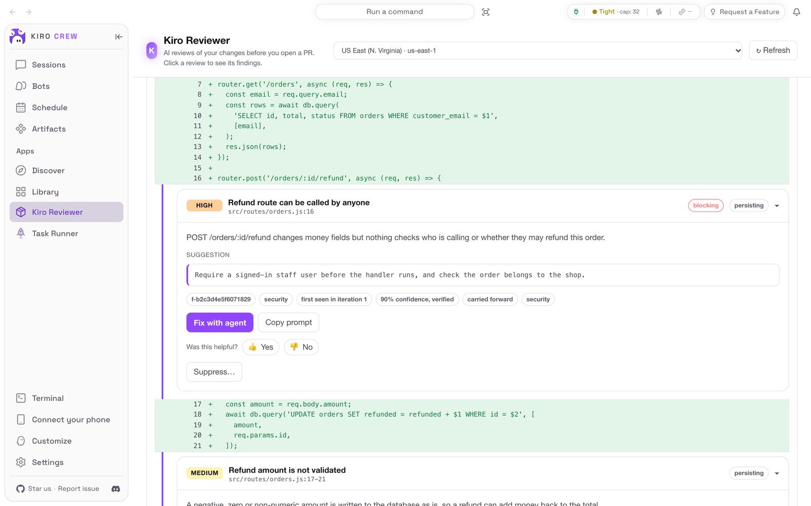
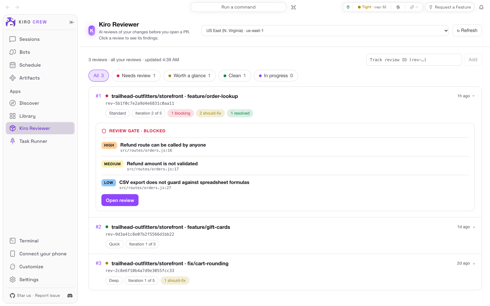
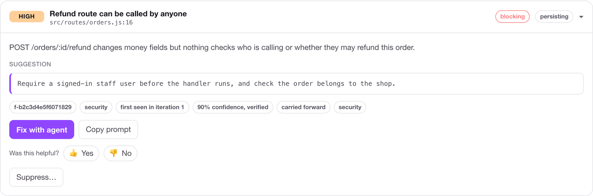
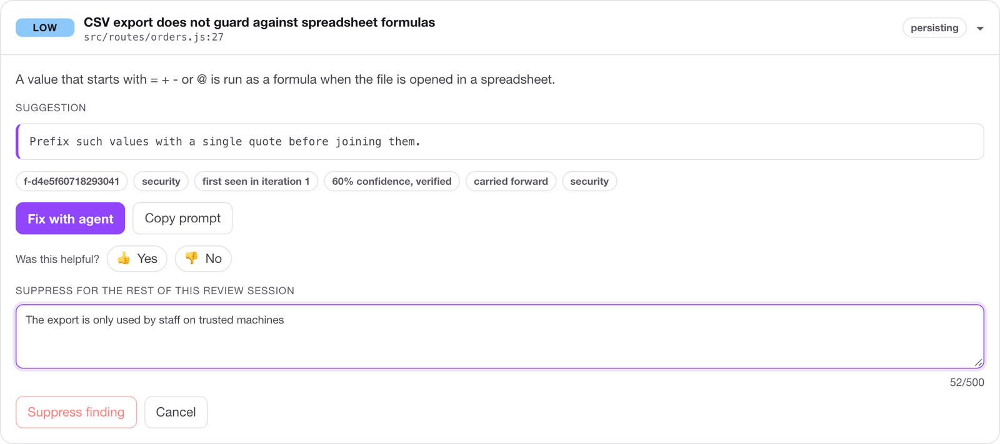
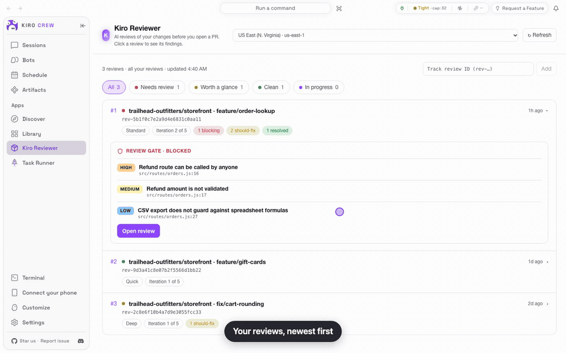

# Kiro Reviewer

<picture>
  <source media="(prefers-color-scheme: dark)" srcset="docs/media/hero-dark.png">
  
</picture>

**Get an AI review of your changes before you open the pull request.**

Kiro Reviewer is an app for [Kiro Crew](https://github.com/kirodotdev/KiroCrew),
the open-source personal AI agent.

## What it is

Kiro Reviewer adds a **Kiro Reviewer** page to the Kiro Crew sidebar and lets your Kiro Crew agent review your git
changes in chat. You ask for a review, the agent shows you exactly what would be sent, and after you agree it sends the
change to the Kiro review service. The findings come back in the chat and on the page, placed under the changed lines
they are about.

**Get started:** Open **Apps → Discover**, find **Kiro Reviewer**, choose **Install**, then **Enable**. See [Install](#install) for the details.

## The problem it solves

You have finished a change and want a second pair of eyes before anyone else sees it, but a pull request puts your
half-checked work in front of your team. You also do not want to paste code into a review tool by hand, or send secrets by
accident.

Kiro Reviewer gets a review while the change is still yours. It gathers the change from your own git repository,
blanks out anything that looks like a secret, and shows you what it will send before it sends anything. It never sends
files it was not allowed to, and it never changes your code on its own: it only reports findings, and you decide what to
do with each one.

## Top 3 use cases

### 1. Review a branch before you open a pull request

You are on a feature branch and want feedback before you ask a teammate. In a Kiro Crew chat you ask the agent to review
your changes against your main branch. The agent shows what it will send. You say yes, and the findings appear in the
chat, sorted by how serious they are. The **Kiro Reviewer** page lists every review with its branch, how long ago it
ran and what it found, and **Open review** shows the details.



### 2. Fix a finding with the agent

A review reports a real problem, such as user input put straight into a database query. On the **Kiro Reviewer** page you
open the review and find the finding under the line it is about. Choose **Fix with agent**. That opens a chat in
which the agent first checks the finding against your code and only then changes it. After you fix it you ask for the
review again, and the finding shows as resolved.



### 3. Set aside a finding that is wrong

The reviewer sometimes flags something that is fine in your situation. Choose **Suppress…** on the finding, type a
short reason, and choose **Suppress finding**. It stops counting for the rest of that review. Under **Was this
helpful?** you can also choose **👍 Yes** or **👎 No** so the reviewer team knows whether it helped.



## Watch it



[Watch the walkthrough as a video (MP4)](docs/media/walkthrough.mp4).

<sub>Recorded from a real Kiro Crew (release 0.13.0) on a throwaway home with this repository installed. The reviews
are made up: a capture-only build of the page's backend answered from demo data
([`capture/stub_bff.mjs`](capture/stub_bff.mjs)) instead of the Kiro review service, so no review was sent anywhere.
The recording shows the page only, not a chat with the agent.</sub>

## Install

**From the Kiro Crew App Store**

1. In Kiro Crew, open **Apps → Discover** in the left sidebar.
2. Search for **Kiro Reviewer** and choose **Install**.
3. Kiro Crew asks **Trust “Kiro Reviewer” to run its own code?** The app needs its own code to read your git
   repository on your computer and to talk to the review service. Trusting it gives that code the same access Kiro Crew
   has (your files, your saved sign-ins and the internet), as the dialog says. Choose **Trust this app**. You can take it
   back later in **Settings → Security → Third-party apps**.
4. The app installs switched off. Choose **Enable** on its page. It then shows up under **Apps** in the sidebar and in
   **Apps → Library**.

**What you need:** a Mac or a Linux computer with `git` and Node.js 22 or newer installed, and a Kiro account. The
**Kiro Reviewer** page uses the Kiro sign-in you already have in Kiro Crew (**Settings → Agent → Kiro sign-in**). To
ask for reviews in chat you also need a Kiro API key; see [First run](#first-run). Chat tool results appear as a card
only when the shared MCP gateway is on (**Settings → Shared MCP gateway**); otherwise you get the same information as
plain text.

**Runs its own code:** this app ships a page backend, an MCP server and an enable-time check script, so Kiro Crew runs it
only for a third-party app you trust. If Crew refuses the install or the enable with `app_execution_denied`, turn on
**Settings → Security → Third-party apps** (`agent.apps_allow_third_party` in `config.json`), or trust this app alone as
in step 3 above.

## First run

The **Kiro Reviewer** page opens with your reviews list. If you have not asked for a review yet, it is empty.

The page works as soon as you are signed in to Kiro in Kiro Crew. To ask for a review **in chat**, give the app a Kiro
API key once: set it as `KIRO_API_KEY` where Kiro Crew runs, or save it in the app's data folder (see
[Settings & data](#settings--data)). Then ask the agent to check the Kiro Reviewer setup, and it reports what is
missing.

## How to use it

1. In a Kiro Crew chat, ask the agent to review your changes, for example: "Review my changes against origin/main with
   Kiro Reviewer." You can ask for a quick, standard or deep review.
2. Read the summary the agent shows. It lists the files, what was blanked out as a secret, and what will be sent. Say
   yes to send it. Nothing is sent before you do.
3. The reviewer may ask for more files to understand the change (up to two rounds, and you have about two minutes to
   answer each). The agent shows what it would share. Agree, or tell it to decline any file.
4. Read the findings in the chat, or open **Kiro Reviewer** in the sidebar and select the review to see each finding under
   its diff line.
5. For each finding, choose **Fix with agent**, **Copy prompt**, or **Suppress…** with a reason. **Copy for CR/PR** copies
   a short summary for your pull request.
6. After you change your code, ask the agent to send the review again. The page shows what is new, what is resolved
   and what is still open.

Limits you will meet:

- The change can be at most about 1 MB of diff. Generated, lock and vendored files are left out by the service.
- A review has at most 2 rounds in which the reviewer can ask for extra context.
- The review covers committed changes against the branch you name. Ask for uncommitted changes explicitly.
- **Unsuppress** does not reach the service yet: the page shows the finding again, but the service keeps suppressing it.
- The page reads reviews from your Kiro account, but the diff placed under each finding is only available for reviews
  sent from this computer.

## Settings & data

- **Where your data lives:** `~/.kiro/crew/apps/kiro-code-reviewer/data/` (or under `$KIROCREW_HOME` if you set it).
  It holds your list of reviews, the diffs this computer sent, and optional settings in `config.json`. Prepared
  payloads are kept for 30 minutes.
- **What leaves your computer:** only after you say yes, the redacted diff, commit messages (no author names, emails or
  times), the rules file `REVIEW.md` and any files you approved go to the Kiro review service at `https://app.kiro.dev`
  (or `https://eu-central-1.app.kiro.dev` if you pick the Europe region on the page). Your API key goes only to that
  address.
- **Your API key:** set `KIRO_API_KEY`, or save it as the first line of `data/kiro-api-key` and make it private with
  `chmod 600`. It is never stored in the app's code or settings.
- **Turn it off:** **Apps → Library**, open the **⋯** menu on Kiro Reviewer, choose **Disable**. Your data is kept.
- **Remove it:** the same menu, **Uninstall**. **Keep app data** is ticked by default; untick it to delete the data too.

## Troubleshooting / FAQ

**The agent says the Kiro Reviewer is not set up, or a tool fails about a key.**
Ask the agent to check the Kiro Reviewer setup and read the result to you. Most often the Kiro API key is missing; see
[First run](#first-run).

**The page says I am not signed in.**
Sign in to Kiro in **Settings → Agent → Kiro sign-in**, then reload the page.

**The reviewer asked for context, but nothing happened.**
You have about two minutes to answer. After that the review continues without the extra files, and the result says it
was reviewed without some requested context.

**A file I wanted the reviewer to see was refused.**
The app never shares files outside your repository, anything under `.git`, or files whose names look like secrets (such
as `.env`, private keys and credentials files). That is by design.

**The results show as plain text instead of a card.**
Turn on the shared MCP gateway in **Settings → Shared MCP gateway** and make sure MCP Apps are on.

**I changed the app's code and the page did not update.**
Turn the app off and on in **Apps → Library** so its backend restarts, then reload the page.

## Development

Layout: `src/` (the review tools and the page backend), `backend/` (the Python hook that signs the page in through
the gateway), `ui/` (the page), `card/` (the chat card), `skills/` (the agent's instructions), `test/` and `test_py/`
(tests). The sections below describe how it works.

### Install from a clone

New to this app? Build the bundle, install it into your Crew, trust and enable it, then give the MCP tools a Kiro API
key. Each step links to the section with the full detail.

**Prerequisites:** Node 22, and a Crew with the **shared MCP gateway** on (`mcp_gateway.enabled`;
Settings → Shared MCP gateway, MCP Apps enabled). Without the gateway the tools still run but return plain text
(see [Crew page](#crew-page)).

```bash
# 1. Build the bundle (dist/ is git-ignored; kirocrew app install copies dist/ but not node_modules).
npx -y npm@11.6.2 ci && npm run build      # the npm@11.6.2 pin matters — see Build, test, lint

# 2. Install, trust, enable.
kirocrew app install "$PWD"
kirocrew app enable kiro-code-reviewer     # requires agent.apps_trusted to contain kiro-code-reviewer
kirocrew restart
```

**3. Give the MCP tools a Kiro API key.** The default endpoint is the Kiro BFF at `https://app.kiro.dev`, but the two
halves of the app authenticate differently:

- The **Crew page** uses Crew's own Kiro sign-in through the gateway — no secret to place. Just be signed in to Kiro
  (Settings → Agent → Kiro sign-in).
- The **MCP tools** (`code_review_*`, what you run from chat) **cannot read the sign-in vault** — the sandboxed MCP
  server has no gateway credential. They fall back to a Kiro API key, and without one they can't call the BFF. Provide
  it via `KIRO_API_KEY`, or the first line of `~/.kiro/crew/apps/kiro-code-reviewer/data/kiro-api-key`
  (`chmod 600`, not readable by others):

  ```bash
  install -m 600 /dev/null ~/.kiro/crew/apps/kiro-code-reviewer/data/kiro-api-key
  printf '%s' "$YOUR_KIRO_API_KEY" > ~/.kiro/crew/apps/kiro-code-reviewer/data/kiro-api-key
  ```

Then open the **Kiro Reviewer** page in the dashboard, or submit a review from Kiro chat.

No secrets live in the repo or in config — the API key stays in your local data dir. Full details, the trust grant, and
the non-default `KIROCREW_HOME` caveat are in [Installing into Kiro Crew](#installing-into-kiro-crew-manual-step);
build/test/lint commands and the npm pin are in [Build, test, lint](#build-test-lint).

### Tools

| Tool                          | Auto-approve | Network             | What it does                                                                                                                                                                                                                                                                                                                                                                                     |
| ----------------------------- | ------------ | ------------------- | ------------------------------------------------------------------------------------------------------------------------------------------------------------------------------------------------------------------------------------------------------------------------------------------------------------------------------------------------------------------------------------------------ |
| `code_review_prepare`         | yes          | no                  | Diff from the merge-base of `base` and HEAD, `REVIEW.md` from the merge-base, approved context files; redacts secrets; checks the service's input limits; stages the payload (`<dataDir>/prepared/prep-<16hex>.json`, 0600, 30 min); returns `preparedId`, `payloadDigest`, `summaryMarkdown` (≤ 4,000 chars)                                                                                    |
| `code_review_submit`          | yes          | yes                 | Re-reads the staged payload; byte-exact digest check (`DIGEST_MISMATCH` / `PREPARED_NOT_FOUND`, no network); then the Kiro BFF `CreateCodeReview` (new) or `UpdateCodeReview` (resubmit)                                                                                                                                                                                                         |
| `code_review_get`             | yes          | yes                 | Polls `GET /reviews/{id}` every 5 s for up to `waitSeconds` (0..90, default 60); one call never exceeds `waitSeconds + 20 s`; returns structured results plus Markdown                                                                                                                                                                                                                           |
| `code_review_suppress`        | yes          | yes                 | `POST /reviews/{id}/findings/{fid}/suppress` with an optional reason (≤ 500 chars)                                                                                                                                                                                                                                                                                                               |
| `code_review_context_prepare` | yes          | yes (read-only GET) | Reads `GET /reviews/{id}`, answers each open context request locally (file / line range / `git grep` search at the reviewed commit), applies path refusals and the user's `decline` list, adds approved `extraFiles`, redacts, checks the round limits and stages a digest-bound payload (`kind: 'context'`); returns `preparedId`, `payloadDigest`, `summaryMarkdown`, `expiresAt`, `decisions` |
| `code_review_context_submit`  | yes          | yes                 | Same digest check as `code_review_submit` (and rejects a staged review payload with `PREPARED_KIND_MISMATCH`), then the Kiro BFF `UpdateCodeReviewContext`; maps a late answer to `CONTEXT_WINDOW_CLOSED`                                                                                                                                                                                        |

`code_review_prepare` also takes `contextRounds` (0..2, **default 2** for new reviews; `0` opts out) and
`includeManifest` (default true; the manifest is sent only when rounds are enabled or on a resubmit).
`includeChangedFiles` (default true; `false` opts out) also sends the full text of the modified and renamed files, like
the GitHub action's `include-changed-files`, so the reviewers see whole files rather than hunks. The files are read like
context-round answers (same path refusals, at HEAD or from the working tree with `includeUncommitted`), redacted, and added to
`context` after the user's `contextFiles`. A file that does not fit the remaining context limits (20 files, 100 KB
each, 200 KB total) is not sent; the summary lists every changed file it left out and why. Added files are not
attached, since the diff already carries them whole.
`code_review_get` returns at once on `NEEDS_CONTEXT` with an `AWAITING` round (structured `needsContext: true`) with
the requests rendered, because the answer window is about 2 minutes. While a submitted round is still being applied
(`NEEDS_CONTEXT` with the round `RESPONDED`/`APPLIED`, or a closed round being resumed) it keeps polling, bounded by
`waitSeconds`, until the status changes or a new round is `AWAITING`; if the wait elapses first it returns
`stillRunning: true` with "📨 … is applying the submitted context." (Before this, a get right after
`code_review_context_submit` returned NEEDS_CONTEXT immediately, 8 times in a row in one observed session.)

### Context rounds (client side)

Flow: prepare → submit (`contextRounds: 2`, `manifest`) → get → `NEEDS_CONTEXT` → `code_review_context_prepare` →
the agent shows `summaryMarkdown` → `code_review_context_submit` → get. If the window closes first, nothing is sent and
the service reviews without the context after 120 s; the result then says "Reviewed
without some requested context (not fully informed)" and lists what was declined, not found or not provided. At most
2 rounds per review session (`MAX_CONTEXT_ROUNDS_PER_REVIEW`, mirrored from the service).

- **Manifest:** names only, from `git ls-tree -r --name-only -z <headSha>` (or `git ls-files -z` with
  `includeUncommitted`), path-rule and denylist filtered, capped at 2,000 and sorted by shared directory prefix with
  the changed files; the prepare summary shows only its count.
- **Summary:** every request's id, kind, target and the model's `reason` (escaped, truncated to 300 chars, treated as
  untrusted data), the decision and bytes, redactions and the deadline. The agent shows it, then submits.
- **Client-side refusal** (`src/safety.ts`), sent as `declined` with the local reason in the summary:
  empty/absolute/`~`/`..`/backslash/control-character paths ("refused: invalid path"); a realpath outside the repo or
  under `.git/` ("refused: outside repository"); and `SECRET_PATH_DENYLIST` ("refused: secret-like path",
  case-insensitive): basenames `.env`, `.env.*`, `id_*` key files (`/^id_[^.]*(\.pub)?$/`), `credentials[-_.]*`,
  `kubeconfig`, `kubeconfig-*`, `kubeconfig_*`, `.netrc`, `.npmrc`, `.pypirc`, `.pgpass`, `.htpasswd`, `.dockercfg`, `.boto`, `.git-credentials`,
  `.envrc`, `secret(s)[-_.]*`, GCP key JSON (`*service-account*.json`, `sa.json`, `key.json`, `sa-key.json`,
  `gcp`/`gcloud`/`google` names with an `sa`/`key`/`creds` part such as `gcp-sa.json`, `application_default_credentials.json`, `client_secret*.json`); extensions
  `.pem .key .p12 .pfx .jks .keystore .ppk .tfstate .asc .gpg .p8 .tfvars .tfvars.json .kdbx`; any segment
  `.aws .ssh .gnupg .kube .docker`. A trailing backup suffix (`.bak .backup .old .orig .save .tmp ~`) on any path segment is ignored
  before matching. Search results
  drop matches in denylisted files and the manifest never lists them. Binary/non-UTF-8 → "not text"; over 100,000
  bytes or the round's `maxBytes` → "too large".
- Limits mirror the service: `contextResponse.unsolicitedFiles` 8, `contextResponse.entryBytes` 100,000,
  `contextResponse.totalBytes` 200,000, `context.iterationTotalBytes` 300,000, `manifest.paths` 2,000,
  `context.rounds` 2.

### Git metadata (client side)

`code_review_prepare` takes an optional `intent` string (a one-paragraph description of what the change is meant to
do) and collects commit messages for the reviewed range. Both are sent as the payload's `intent` and `commits`
fields; see the service README's "Git metadata" for how the reviewer treats them (untrusted author claims; `intent`
is a Find-only spec-drift signal; neither suppresses a finding).

- **Commit collection** (`src/collect/git.ts`): `git log --format` with a metadata-free format (`%s` subject, `%b`
  body, `\x00`/`\x1e` separators) over `merge-base..HEAD` (or `merge-base..` working-tree HEAD with
  `includeUncommitted`), newest first. **Author, email and timestamp are never collected.** Capped at 50 commits and
  8,192 utf-8 bytes (drop oldest past 50, then truncate bodies), so the client stays within the server limit.
- **Redaction:** `intent` and every commit subject/body are run through `redactText` before staging, so a secret in
  any of them is `[REDACTED]` in the staged payload and counted in the summary's redaction locations.
- **Limits mirror the service** (`src/limits.ts`): `intent.chars` = `LIMITS.intentChars` 2,000 code points,
  `commits.count` = `LIMITS.commitCount` 50, `commits.bytes` = `LIMITS.commitBytes` 8,192 summed utf-8 bytes. The
  constants are identical to the service so a client pre-check fails exactly as the service would.
- **Approval summary:** the summary renders an "Author intent (your claim, shown to the reviewer as untrusted)"
  excerpt (bounded) and a line "Commit messages: N (B bytes), R derived refs; author/email/timestamp excluded". The
  derived refs are computed server-side (trailers + inline ticket/`sim:`/`cr:` ids); the count shown here is the
  client's own view.
- **Skill:** `skills/code-review/SKILL.md` instructs the agent to write a one-paragraph `intent` from its task before
  `code_review_prepare` and to note it is shown in the approval summary and treated as an untrusted claim.

### Finding responses on resubmit (client side)

On a **resubmit** (`code_review_prepare` with `reviewId`), `code_review_prepare` takes an optional `responses` array
recording the author's disposition of each previous-iteration finding the user wants to address. It is sent as the
payload's `responses` field; see the service README's "Finding responses on resubmit" for how the service applies and
threads them.

- **Shape:** `responses: Array<{ findingId, disposition, comment?, acknowledged? }>`, `disposition` one of
  `fixed | false_positive | wont_fix | deferred | question`. `responses` is **rejected on a new review** (requires
  `reviewId`), and dropped from the payload on a new review by `buildPayload`.
- **Blocking acknowledgement:** the skill sets `acknowledged: true` on a **blocking** finding only when the user said
  to set that finding aside; without it the service records the dismissal as a surfaced no-op and never reduces
  `counts.blocking`. The dispositions appear in `summaryMarkdown`.
- **Redaction:** each response `comment` is run through `redactText` before staging, like `intent` and commit text.
- **Limits mirror the service** (`src/limits.ts`): `responses.max` = `LIMITS.responsesMax` 50, `responses.commentChars`
  = `LIMITS.responseCommentChars` 1,000 code points.
- **Thread rendering:** `code_review_get` renders each active finding's `thread` entries (author, iteration, escaped
  text) inside its `<details>` block, plus a "blocking, dismissed by author" or "claimed fixed, still present" badge
  when the service set those flags. All thread text is escaped (untrusted model/author data).

### Configuration (read on every tool call)

The app always talks to the Kiro BFF. Env first, then `<dataDir>/config.json`
(`{ "bffEndpoint", "kiroRegion" }`).

**The page** calls the BFF through the Crew gateway with Crew's own Kiro sign-in (`backend/`, below) — no secret to
place. **The MCP tools** call the BFF directly with a Kiro API key, because the sandboxed MCP server cannot read the
sign-in vault. Give the server a key:

- `KIRO_API_KEY`, or the first line of `<dataDir>/kiro-api-key` (the file must not be readable by others: `chmod 600`).

Endpoint and region:

- `KIRO_CODE_REVIEWER_BFF_ENDPOINT` or `config.json` `bffEndpoint`: a bare https origin. The default is prod,
  `https://app.kiro.dev`. Set `bffEndpoint` to use another origin, for example for testing.
- `config.json` `kiroRegion`: `us-east-1` (default, `https://app.kiro.dev`) or `eu-central-1`
  (`https://eu-central-1.app.kiro.dev`). The page's region selector writes it; `bffEndpoint` wins over it.
- `KIRO_CODE_REVIEWER_DATA_DIR`: default `~/.kiro/crew/apps/kiro-code-reviewer/data`.

No secrets are stored in the repo or the config; the API key stays in the local data dir.

`src/client/bffApi.ts` maps each tool to a BFF operation
(`CreateCodeReview`, `UpdateCodeReview`, `GetCodeReview`, `ListCodeReviews`, `UpdateCodeReviewFinding`,
`UpdateCodeReviewFeedback`, `UpdateCodeReviewContext`, `GetCodeReviewIterationPayload`) over Smithy RPC v2 CBOR
(`src/client/bff.ts`), and maps the reply back. Un-suppress has no BFF operation and fails as `UNSUPPORTED`. The BFF
leaves `counts` off an unfinished iteration; the tools see zeros. `code_review_status` checks the endpoint and the key
with one read of a review id that cannot exist. The key is sent only to the configured endpoint, and a redirect is
refused. The BFF has its own request size limit (2,000,000 bytes once it is deployed), so a request over 1,000,000 bytes is refused by the BFF until then.

### Kiro sign-in through the gateway (`backend/`)

No API key: the page calls the BFF with Kiro Crew's own Kiro sign-in. `app.json` `backend.hooks.routes` loads `backend/routes.py` into the Crew gateway,
which serves:

- `POST /api/apps/kiro-code-reviewer/kiro/{operation}`: a JSON object in, the BFF's output out. Only the eight review
  operations in `OPERATIONS` are forwarded (`CreateCodeReview`, `UpdateCodeReview`, `GetCodeReview`, `ListCodeReviews`,
  `GetCodeReviewIterationPayload`, `UpdateCodeReviewContext`, `UpdateCodeReviewFinding`, `UpdateCodeReviewFeedback`).
- `GET /api/apps/kiro-code-reviewer/kiro/status`: whether a Kiro sign-in is stored, with no BFF call.

The code runs in the gateway because only the gateway can read Kiro Crew's sign-in vault. It gets the token from Crew's
`KasAuthProvider` (with the `KIRO_API_KEY` bypass off) and calls the BFF over Smithy RPC v2 CBOR with the Kiro
identity headers (`Authorization`, `X-Kiro-Idp`, `X-Kiro-Profile-Arn`, `TokenType`). App Kit documents
`kiro_crew` imports as built-in only; this app imports `kiro_crew.auth` on purpose (see `backend/kiro_token.py`).
The gateway has no CBOR library, so `backend/cbor.py` is a stdlib codec.

Callers: this app's own backend (its app token) and the dashboard owner. The endpoint is `https://app.kiro.dev`
unless `data/config.json` names another as `bffEndpoint` or picks a `kiroRegion`.

**Page backend transport.** The page backend uses `kiro` by default (Crew hands it its app secret); `"transport"` in
`data/config.json` or `KIRO_CODE_REVIEWER_TRANSPORT` overrides it. The Crew page then makes every call (list, read, suppress, feedback, payloads) through the same REST-to-operation mapping
as the `bff` transport (`src/client/bffApi.ts`), with the operation sent to the hook instead of to the BFF
(`BffConfig.send`, `src/client/gateway.ts`). The page backend checks `KIROCREW_GATEWAY_ORIGIN_PROOF`, exchanges its app
secret for an app token and sends that as the gateway cookie. Not on this transport: the MCP tools. The sandboxed MCP
server has no gateway credential, so under `kiro` they fail with `KIRO_GATEWAY_UNAVAILABLE`; use `bff` for them.

Loading: Crew loads a hook by file path with no parent package, so `backend/routes.py` and `backend/bff.py` fall back to
loading their sibling modules by path (`test_py/test_hook_path_load.py`).

Tests: `<kirocrew dev venv>/bin/python -m pytest test_py` (needs `kiro_crew`, `aiohttp`, `pytest-asyncio`). The dev
venv's Crew can differ from the installed one, so also run `scripts/check_hook_in_installed_crew.py` with the installed
Crew's Python (usage in the script); it exits non-zero unless both hook routes register.

### Naming

App id `kiro-code-reviewer` (install path `~/.kiro/crew/apps/kiro-code-reviewer/`), MCP server `code-reviewer`,
launcher `bin/kiro-code-reviewer-mcp`, skill `skills/code-review`. The MCP tool names (`code_review_*`) name the
action, not the product.

### Service results shown

- **Limits:** the client pre-checks the same input limits as the service; `rules.reviewMdBytes` is 131,072 bytes
  (128 KB).
- **File exclusion:** the client sends the whole diff; the service excludes generated, fixture, lock and vendored
  files. The prepare summary says so, `code_review_submit`
  lists the excluded files (count + first 20) and returns `excludedFiles`, and `code_review_get` prints an
  "Excluded from review" line.
- **Result cache:** when the service reused an identical earlier result (same tenant, diff lines, rules, context and
  level), `code_review_get` prints "♻️ Cached result from <cachedAt> … no model calls". The iteration still counts
  toward the iteration budget.

All new response fields are optional, so older service responses render as before.

### First-party agent tools

`app.json` also declares the seven tools as `agentTools` (namespace `code_review`, route `agent-tools`), generated
from `src/tools/registry.ts` by `npm run agent-tools`; a test fails when the block is stale. Kiro Crew reads the block
only for a first-party app. It then lists the tools under `kirocrew-core` and forwards each call through the signed
proxy to the page backend's `POST /api/agent-tools`, so the tools use the page's transport, Kiro sign-in, region and
data dir. Crew's argument names are snake_case (`repo_path`), and `responses` is passed as a JSON-encoded string.
Once the app ships first-party, drop `mcpServers` so the tools are not listed twice.

### Crew page

The app adds a **Kiro Reviewer** page (`ui/index.mjs`, plain ESM, no build step) served by a loopback backend
(`dist/ui-backend.mjs`, built from `src/ui/backend.ts`). The backend binds `127.0.0.1` and rejects every request
except `/health` that lacks the gateway's `X-KiroCrew-Proxy` HMAC.

- **Review list:** reviews from `<dataDir>/reviews.json` (written by `code_review_submit`, or added by ID in the page).
- **Findings in the diff:** findings are placed under the diff line they point to, from the payload this machine
  sent (`<dataDir>/reviews/<reviewId>/`, 0600). Filters, search, and an iteration delta line.
- **Act on a finding:** _Fix with agent_ opens a Crew chat with a prompt that frames the finding as untrusted data
  and asks the agent to verify it before changing code; _Copy prompt_; _Fix N with agent_ for all blocking
  findings; suppress with a reason.
- **Feedback:** 👍 / 👎 with an optional reason and comment.
- **Hand-off:** _Copy for CR/PR_ puts a short review summary on the clipboard.
- **Context tab:** rules, context files and context rounds that were sent.

Four page features need service APIs that are requested but not built yet:
finding feedback, a review list, reading back an iteration's payload, and unsuppress. Unsuppress is stubbed with a
local override only: the page shows the finding as active again and says the service still suppresses it. Until then the backend serves them from
local stub data (`<dataDir>/feedback.json`, `reviews.json`, the stored payloads). Turn each on when the service
ships it, in `<dataDir>/config.json`:

```json
{ "serviceApis": { "feedback": true, "list": true, "payload": true, "unsuppress": true } }
```

`list` defaults to `true` (the BFF has ListCodeReviews); set it to `false` to show only this machine's reviews. With it on, the page follows every page of the list, up to 1,000 reviews.

After changing backend code, turn the app off and on in the Crew dashboard so its backend restarts; UI files are
served from disk and need only a page reload.

### Chat card (MCP Apps)

`code_review_get`, `code_review_prepare` and `code_review_context_prepare` declare `_meta.ui.resourceUri =
ui://kiro-code-reviewer/card`. The server serves `dist/card.html` (built from `card/`; one self-contained file in Crew's
design tokens, whose CSP allows only Crew's two web fonts from Google Fonts) as `text/html;profile=mcp-app`, and Kiro Crew renders it inline in the chat from the tool's
structured result:

- **Review result:** status, counts, severity bar, iteration delta, the top findings (expandable), suppressed
  findings as dimmed rows with their reason, _Copy fix prompt_ for the blocking findings and _Copy for CR/PR_.
- **Approval summary** (`prepare`, `context_prepare`): what would be sent, with the redaction count and the digest.
  Display only.

Requires the Crew **shared MCP gateway** (`mcp_gateway.enabled`; Settings → Shared MCP gateway) with MCP Apps on.
Without it the tools return their text as before. All review text is escaped before it reaches the markup
(`card/render.mjs`, tested in `test/card.test.ts`).

### Build, test, lint

```bash
npx -y npm@11.6.2 ci                         # see the install note below
mkdir -p build-logs
npm run build > build-logs/build.log 2>&1   # tsc --noEmit + esbuild -> dist/server.mjs (target node22)
npm test > build-logs/test.log 2>&1         # vitest run --coverage
npm run lint > build-logs/lint.log 2>&1     # eslint src test scripts && prettier --check .
```

`dist/` is git-ignored; build it before installing the app.

Install note: npm 11.3.0 crashes with `Cannot read properties of null (reading 'edgesOut')` while resolving the vitest
4.1.12 peer set on a fresh install, so `package-lock.json` was generated with `npx npm@11.6.2 install`. npm 11.3.0 also rejects the lockfile in `npm ci` (EUSAGE, missing optional `@emnapi/*`), so
install with `npx -y npm@11.6.2 ci`. All versions are pinned exactly.

### Smoke test (live)

```bash
npm run build
KIRO_API_KEY=<your-kiro-api-key> npm run smoke   # prod https://app.kiro.dev; KIRO_CODE_REVIEWER_BFF_ENDPOINT picks another origin
```

`scripts/smoke.ts` builds temporary synthetic repos, spawns `node dist/server.mjs` over MCP stdio and calls prepare →
submit → get, answering context rounds through `code_review_context_prepare` and `code_review_context_submit`.
Scenario A adds string-concatenated SQL from request input and must end in `FINDINGS`. Scenario B makes the reviewer
ask for context and must end `COMPLETED` with the context provided. Scenario C submits one review and resubmits it
twice, so the Crew page shows three iterations with deltas, resolved findings and a question thread. Run only some
with `KIRO_CODE_REVIEWER_SMOKE_SCENARIOS=C` (comma list). It exits 0 only if every scenario prints PASS, and deletes
the temp repos.

Set `KIRO_CODE_REVIEWER_SMOKE_DATA_DIR=~/.kiro/crew/apps/kiro-code-reviewer/data` to send from the Crew app's data
directory and keep it, so the runs appear in the Crew page. **Running the harness is the operator's explicit
approval** to send the synthetic payloads.

### Installing into Kiro Crew (manual step)

The implementation never changes your Crew configuration. To install for real:

1. `npx -y npm@11.6.2 ci && npm run build` (the bundle must exist; `kirocrew app install` copies `dist/` but not `node_modules`).
2. `kirocrew app install /path/to/this/repo`
3. Grant trust for this third-party app (`agent.apps_trusted` must contain `kiro-code-reviewer`); without it Crew refuses the
   MCP registration and lifecycle scripts.
4. `kirocrew app enable kiro-code-reviewer`, then `kirocrew restart`.
5. Give the MCP tools a Kiro API key: set `KIRO_API_KEY` in the environment Crew runs in, or write the first line of
   `~/.kiro/crew/apps/kiro-code-reviewer/data/kiro-api-key` (`chmod 600`). The page uses Crew's Kiro sign-in and needs
   no secret.

Limitations:

- The launcher path in `app.json` is `~/.kiro/crew/apps/kiro-code-reviewer/bin/kiro-code-reviewer-mcp`. A non-default
  `KIROCREW_HOME` requires editing that `command` (kiro-cli expands `~` in `command` but not in `args`).
- Whether the installed kiro-cli honors `autoApprove` is unverified. If it is ignored, `prepare` and `get` also prompt
  (safe, but noisy). Still unobserved: the smoke harness drives the MCP server directly, and the real
  install is a manual user step. Record the observed behavior here after the first real install.

The install was validated in an isolated home with no trust grant:

```bash
T=$(mktemp -d)
KIROCREW_HOME="$T" KIRO_HOME="$T/kiro" kirocrew app install "$PWD" > build-logs/crew-install.log 2>&1
rm -rf "$T"
```

### Security posture

- Git runs via `execFile` with argument arrays (never a shell), `--end-of-options`, a 2 MB output cap and a 30 s
  timeout. Base refs must match `^[A-Za-z0-9._/@^~-]{1,200}$` and must not start with `-`.
- Context files must resolve (after `realpath`) inside the repository, not under `.git/`, and be UTF-8 without NUL.
- Redaction replaces only secret values with `[REDACTED:<type>]`.
- Logs go to stderr only and contain tool names, IDs and error codes, never diffs, paths, rules or findings.

### Re-capture the README media

The pictures and the recording come from a real, isolated Kiro Crew gateway driven by [`capture/`](capture/README.md).
After any change to what the app shows:

```bash
npx -y npm@11.6.2 ci
capture/run.sh /path/to/KiroCrew
python capture/check_readme.py
```

`capture/run.sh` builds a scratch copy of the app whose page backend answers from the demo data in
`capture/stub_bff.mjs` (`capture/demo-backend.mjs`), then runs `capture/capture.py` on it and writes the media
here.

Then look at every image and at a few frames of the video before committing (see [CHECKLIST.md](CHECKLIST.md)).

## License

Apache License 2.0. See [LICENSE](LICENSE) and [NOTICE](NOTICE). Third-party licenses are in
[THIRD-PARTY-NOTICES](THIRD-PARTY-NOTICES).
